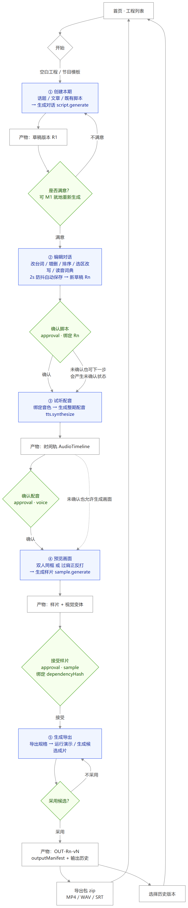
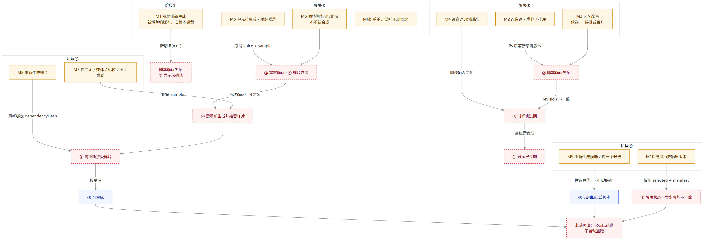

# 23 · 全流程、二次修改点与流程层问题（2026-10-17）

> 依据 **实际代码与运行中的服务** 梳理（25 个 API 动作、`stage_svc` 失效传播、`voice_svc`/`visual_svc` 撤销规则），不是照抄设计文档。
> 图中黄色 = 可二次修改的操作，绿色 = 确认门禁，红色虚线 = 作废/失效传播。





---

## 一、主链路（一张图看懂）

```
首页
 └─ ① 创建本期 ── 生成对话(script.generate) ──► 草稿版本 R1
      └─ ② 编辑对话 ── 改台词/增删/排序/选区改写/读音词典 ── 2s 防抖保存 ──► Rn
           └─ 确认脚本(approval: script, 绑定 Rn)
                └─ ③ 试听配音 ── 绑定音色 ── 生成整期配音(tts.synthesize) ──► 时间轨 AudioTimeline
                     └─ 确认配音(approval: voice)
                          └─ ④ 预览画面 ── 双人同框 / 过肩正反打 ── 生成样片(sample.generate)
                               └─ 接受样片(approval: sample, 绑定 dependencyHash)
                                    └─ ⑤ 生成导出 ── 运行演示 / 生成候选 ── 采用候选 ──► OUT-Rn-vN
                                         └─ 导出包 zip（MP4 / WAV / SRT）或选择历史版本
```

**注意**：这条链是「推荐路径」，不是「强制的唯一路径」。代码允许跨阶段前进（②未确认可去③、③未确认可去④），只是会在页面上给出警告或禁用某些按钮。

---

## 二、逐步说明：每步的输入、产物、门禁与可改性

| 步骤 | 输入 | 动作 | 产物（落在工程的字段） | 门禁 | 能否二次修改 |
|---|---|---|---|---|---|
| ① 创建本期 | 话题/文章/既有脚本 + 节目名/时长/画幅/角色 | `script.generate` | 新增 `scriptRevisions[]`，`currentDraftRevision=Rn` | 无 | ✅ 可就地重新生成（M1），每次都**新增**版本 |
| ② 编辑对话 | 当前草稿 Rn | 改台词、增删话轮、排序、选区改写、读音词典 | 新草稿版本 + `currentDraftRevision` | 确认时校验话轮非空、版本是当前草稿 | ✅ 任意改（M2/M3/M4），确认后可再改 |
| ③ 试听配音 | 已确认脚本 + A/B 音色 | `tts.synthesize` / `units/{id}/adopt` / `audition` / `rhythm` | `audioTimeline`、`audioHistory[]`、`voiceBindings` | 时间轨必须对应当前草稿才能确认 | ✅ 单单元重生成/采纳、调间隔（M5/M6） |
| ④ 预览画面 | 视觉输入 + 脚本 | `visual.generate` / `sample.generate` | `visualVariants[]`、样片 | 必须"接受样片"才能进⑤ | ✅ 换底图/机位/模式、重生成样片（M7/M8） |
| ⑤ 生成导出 | 已确认配音 + 已接受样片 + 导出规格 | `render/generate` → `render/adopt` | `outputManifest`、`outputVersion`、`outputHistory[]` | 采用候选后才算正式成片 | ✅ 重生成候选、换候选、选历史版本（M9/M10） |

---

## 三、二次修改点清单（含"改了之后要付多少代价"）

| 编号 | 在哪一步 | 操作 | 系统实际行为 | 下游代价 | 能否局部重做 |
|---|---|---|---|---|---|
| **M1** | ① | 就地重新生成 | 直接新增一个草稿版本并切为当前；旧版本保留 | ② 需重新确认；③④⑤ 全部过期 | ❌ 整段重生成 |
| **M2** | ② | 改台词 / 增删 / 排序 | 新建草稿版本（不覆盖已用版本） | 脚本确认失配；③ 时间轨过期；④ 样片作废 | ❌ ③ 整期重合成 |
| **M3** | ② | 选区改写 | 先产出**候选**，接受后才合并进草稿 | 同 M2 | ❌ |
| **M4** | ② | 读音词典增删改 | 保存进工程，影响朗读文本 | ③ 时间轨过期（`audio_inputs_match` 失败） | ❌ |
| **M5** | ③ | 单元重生成 / 采纳候选 | **重建整期时间轨**，并撤销 voice + sample 确认 | ③ 重确认、④ 重做样片 | ⚠️ 只换一个单元，但时间轨整体重算 |
| **M6** | ③ | 调整间隔 rhythm | 不重新合成，仅按新间隔重排偏移与总长 | 撤销 voice + sample 确认 | ✅ 真正局部 |
| **M7** | ④ | 换底图/变体/机位/画面模式 | 生成新的视觉变体，撤销 sample 确认 | ④ 需重新接受样片 | ✅ 不必回 ③ |
| **M8** | ④ | 重新生成样片 | 新样片，重新绑定 `dependencyHash` | ④ 重新接受 | ✅ |
| **M9** | ⑤ | 重新生成候选 / 换候选 | 产生新候选，**不自动采用** | ⑤ 仍指向旧正式版本，直到点"采用" | ✅ 可只重生成某段（`reuseMotionArtifactId`） |
| **M10** | ⑤ | 选择历史版本 | 只改 `selectedOutputVersion` + `outputManifest` | 不改 `outputVersion` → 阶段状态/过期提示可能不同步 | ✅ |

**一句话总结代价**：M6/M7/M8/M9/M10 是局部修改；**M1–M5 都会触发"②③④⑤ 连环重做"**，而 M2 的触发门槛只是一个字的改动。

---

## 四、流程层面的问题（比代码缺陷更值得先定的事）

### F1 · 全量作废，没有局部重算（最影响体验）
- 现象：② 改一个字 → ③ 整期重合成（撤销配音+样片确认）→ ④ 重新生成并接受样片 → ⑤ 重新生成候选。
- 代码证据：`voice_svc.py:241,381,461` 在写回时间轨时删除 `voice`/`sample` 确认；`visual_svc.py:35,85` 生成新视觉时删除 `sample`；`stage_svc.py:46-48` 用 `timeline.revision_id != current_draft_revision` 判过期。
- 问题：时间轨内部其实是**按话轮单元**组织的（`SynthesisUnit` 有 id、样本数、哈希），完全具备"只重合成改动话轮 + 其余复用"的条件，但合成入口是整期一次性。
- 建议：把 `tts.synthesize` 改成"按 unit diff 合成"，未变单元复用 `artifactId`；`rhythm` 已经是这个模式（只重排不重合成），可以照抄。
- 预期：改一句 → 从"整期 4 秒~数分钟"降到"单句几百毫秒"，并且不会撤销 ④ 的样片确认（因为音频依赖哈希不变）。

### F2 · 确认记录是"物理删除"而非"标记作废"
- 现象：`approvals` 在 PATCH 里只允许追加（`projects.py:165-172` 校验），但语音/画面副作用里直接 `[a for a in approvals if a.kind not in ('voice','sample')]` 把历史确认删掉。
- 问题：审计链断裂——你看不到"这个版本曾经确认过、因为改了 XX 被作废"；前端缓存的"已确认"和阶段轨"已过期"会短暂打架（前端 P1-8 就是这个根源）。
- 建议：改成 `approvals` 增加 `revokedAt` / `revokedBy` 字段，保留历史；派生"当前有效确认"由 `stage_svc` 统一算。
- 预期：阶段状态、页脚徽章、审计导出三处只有一个事实来源。

### F3 · 门禁有"三套口径"
- 前端按钮 `disabled`（如 `VisualPage.tsx:387` 的下一步只认 `sampleApproved`）；
- 前端派生状态（`voiceApproved`/`sampleApproved` 只看 approval 是否存在）；
- 后端 `stageProgress`（`stage_svc.py`，还叠加 revision/哈希判断）。
- 现象：④ 页脚显示"已确认"、阶段轨显示"已过期"、按钮却可点（或反之）。
- 建议：前端只渲染后端 `stageProgress` 与一个 `canAdvance` 字段，不再自算。
- 预期：三处永远一致，也省掉前端十几处 `some(a => ...)` 判断。

### F4 · ④ 对 ③ 是"弱依赖 + 强否决"
- UI 明说"画面生成不依赖配音"（`VisualPage.tsx:425` 的 warning），但样片确认绑定 `dependencyHash`（含音频输入）→ 改配音必然作废样片。
- 问题：用户感知为"我改的是声音，为什么画面要重做"。
- 建议：把样片的依赖拆成"视觉依赖"和"音频依赖"两个哈希；只有视觉依赖变化才要求重新接受样片。
- 预期：改间隔/换音色不再需要重做画面确认，直接砍掉一轮 ④。

### F5 · 没有分支，无法"两个方案并行试"
- 现状：所有编辑都推进同一个 `currentDraftRevision` 链；历史版本只读，不能"从 R1 另起一版"。
- 建议：允许 `POST /projects/{id}/script/branch` 从任一版本派生新草稿，首页卡片显示"当前分支"。
- 预期：试两种开场白不用互相覆盖，也不用导出两份工程。

### F6 · 合成期间编辑 → 结果静默丢弃，任务仍显示成功
- 代码：`voice_svc.py:238-245`——只有 `current.revision == project.revision` 且草稿一致时才写回 `audio_timeline`，否则只写 `audio_history`，**不报错、不提示**。
- 现象：点了"生成整期配音"，任务成功，但页面上的时间轨没变；用户以为合成没生效，反复点。
- 建议：要么在结果里返回 `applied: false` + 原因并由前端提示"检测到脚本已改动，结果已存为历史版本"，要么直接按 M1 的最优解（只重合成改动单元）避免冲突。
- 预期：消除"假成功"这一类最伤信任的反馈。

### F7 · 失败恢复不对称
- ⑤ 渲染有分段复用与 `resumableVideo` 断点续跑（`recovery.py:40-45`）；
- ③ 合成失败只能整期重来（无单元级续跑）；
- ② 选区改写候选失败后只能重新发起。
- 建议：② 候选与 ③ 单元合成落盘中间结果，任务失败/重启后从已完成单元继续。
- 预期：长任务失败成本从"全部重来"降到"只补失败段"。

### F8 · 两处"生成"语义不一致
- ① 的"生成对话"直接写成一个正式草稿版本（`main.py:59-61` 调 `apply_script_revision`）；
- ② 的"选区改写"是先出候选、接受才合并（`main.py:64-77`）。
- 问题：用户会以为①也能"先看候选再决定"，实际上重新生成总是直接改当前草稿（且会与 2s 防抖抢写，见报告 22 的 P0-3）。
- 建议：统一为"生成 → 候选 → 接受"，或至少在①的重新生成按钮上标明"会替换当前草稿版本"。

### F9 · 二次修改前没有"影响面预览"
- 现状：所有作废都在点击之后发生，UI 不预告"这一改会让 ③④ 失效"。
- 建议：在②的编辑区顶部显示"当前确认链：脚本 R3 ✓ / 配音 S5 ✓ / 样片 ✓"，编辑后实时标黄"将作废：配音、样片"。
- 预期：用户能自己判断"这个改动值不值得重跑三段"。

### F10 · ⑤ 过期后没有"怎么恢复"的路径
- 现状：上游一改，旧成片只标"已过期"，⑤ 页面不说明"需要重新生成候选"，也不给一键入口。
- 建议：过期横幅里直接给"重新生成候选"按钮，并说明哪些输入变了（脚本/配音/画面）。

---

## 五、如果只做三件流程层改造，建议顺序

| 顺序 | 改造 | 解决 | 预估 |
|---|---|---|---|
| 1 | ③ 改成按单元 diff 合成（F1） | 改一句不再重跑三段，M2/M4 的代价断崖式下降 | 2–3 人日 |
| 2 | 确认记录改为可撤销标记 + 后端单一 `canAdvance`（F2/F3） | 三套口径合一，页脚与阶段轨不再打架 | 1–2 人日 |
| 3 | 合成/改写改为"候选 + 明确采用"（F6/F8） | 消除"任务成功但结果没生效"的假成功 | 1 人日 |

F4（拆分视觉/音频依赖哈希）可以和 1 一起做——只有拆开依赖，单元级重合成才能保住 ④ 的样片确认。

---

## 六、附：与设计文档的口径差异（供你核对）

| 文档说法 | 代码实际 |
|---|---|
| 五阶段线性推进，三个确认点（脚本/配音/样片） | 阶段可跳转；②③ 未确认也能进下一步；⑤ 无确认点，靠"采用候选" |
| 确认后修改需重新确认 | 确认记录被直接删除，而非标记作废（F2） |
| 画面生成不依赖配音 | 生成不依赖，但样片确认绑定含音频的 `dependencyHash`（F4） |
| 阶段⑤ 产物为"成片" | 演示模式没有 `outputManifest`，阶段⑤ 永远是"未准备"（报告 22 的 P1-2） |
